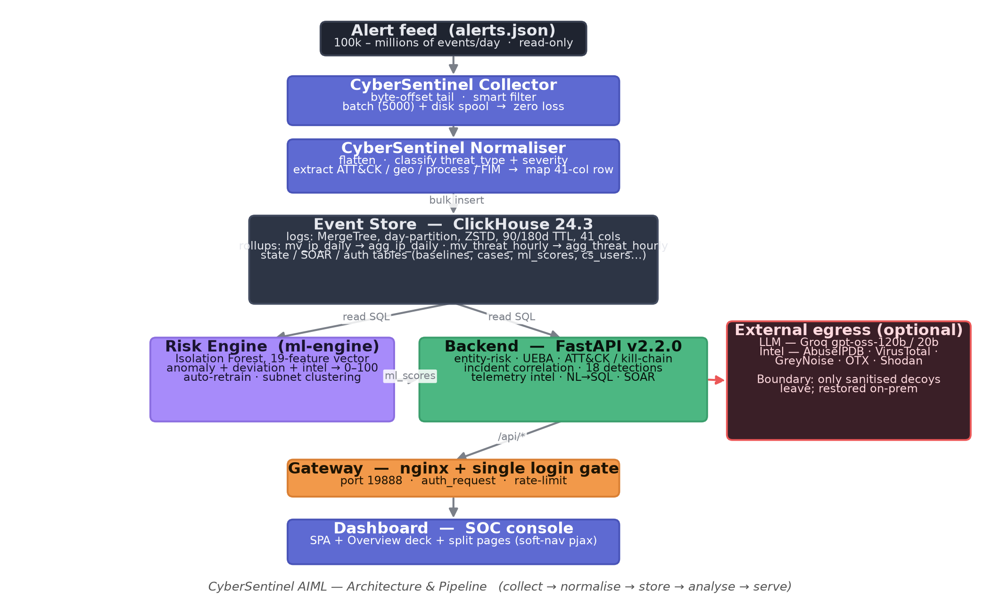

# CyberSentinel AIML — Capabilities, Technology & Roadmap

> **CyberSentinel AIML** is an AI-native SIEM / SOC analytics platform. It ingests
> high-volume bank security telemetry, normalises it into one schema, scores it
> with machine-learning and behavioural models, maps it to the MITRE ATT&CK kill
> chain, and hands a SOC analyst a short list of **prioritised decisions** instead
> of a flood of raw alerts — while keeping the bank's raw data on-premise.
>
> This is the **master reference**: what we have delivered, the technology behind
> it, exactly how each capability works (formulas, thresholds, endpoints), how it
> measures up against market-standard tooling, and — honestly — where it is light
> and what comes next.
>
> _Audience: engineering + technical reviewers. Last rewritten: 2026-10-23._
> _Deployed at: Buldhana Urban Co-op Bank and Aurangabad; ~190M events in the
> production event store. Owner: Tejas (AI/ML, Virtual Galaxy Infotech)._

---

## Table of contents

1. [What CyberSentinel is](#1-what-cybersentinel-is)
2. [What we have delivered & achieved](#2-what-we-have-delivered--achieved)
3. [Technology stack](#3-technology-stack)
4. [Architecture & pipeline](#4-architecture--pipeline)
5. [The data pipeline & event store](#5-the-data-pipeline--event-store)
6. [The analytics engines (in depth)](#6-the-analytics-engines-in-depth)
7. [Capabilities vs market standards](#7-capabilities-vs-market-standards)
8. [The privacy architecture](#8-the-privacy-architecture)
9. [The dashboard](#9-the-dashboard)
10. [Security & access control](#10-security--access-control)
11. [Deployment & operations](#11-deployment--operations)
12. [Performance at scale](#12-performance-at-scale)
13. [API reference](#13-api-reference)
14. [Configuration reference](#14-configuration-reference)
15. [Areas of improvement — gaps & roadmap](#15-areas-of-improvement--gaps--roadmap)
16. [Glossary](#16-glossary)

---

## 1. What CyberSentinel is

A bank SOC drowns in alerts: hundreds of thousands to millions of security
events per day, most of them noise. CyberSentinel sits on top of that firehose
and answers the three questions a SOC lead actually cares about:

- **Who do I look at first?** — a ranked, risk-scored watch-list of entities.
- **Why?** — a plain-English narrative that fuses every engine's signal and maps
  it to the ATT&CK kill chain.
- **What happens next?** — a forward-looking threat forecast that projects live
  detections to their likely next attack stage.

It does this with **built-in AI/ML** (unsupervised anomaly detection plus
per-identity behavioural baselining) rather than static rules alone, so it
catches novel and low-and-slow attacks a signature would miss. Crucially, **the
bank's raw logs never leave the box** — evidence retrieval, query execution and
verdict calculation are all on-premise; only sanitised, decoy-substituted text
is ever sent to an external LLM, and even that is optional.

---

## 2. What we have delivered & achieved

CyberSentinel AIML is not a prototype — it is a working analytics layer running
against real production data. Concretely, what is live today:

- **Production deployment at two banks** (Buldhana Urban Co-op Bank, Aurangabad),
  analysing a single ClickHouse event store of **~190M events** on a host it
  shares with other teams' services — and keeping the dashboard responsive at
  that scale.
- **A full on-premise privacy architecture** — raw logs, internal IPs, usernames
  and SQL results never leave the box. The only external egress is optional,
  on-demand, and carries sanitised decoy values that are restored locally
  (§8). This is the differentiator for a bank buyer.
- **Fused, explainable risk scoring** — three independent engines (unsupervised
  Isolation Forest, per-identity behavioural baselines, and a transparent
  threat-blend) combined into one 0–100 score per entity, each with a
  plain-English verdict and a recommended action — not a black box.
- **18 ATT&CK-mapped detection use-cases** (the full tender use-case list, UC-A …
  UC-R), each backed by a real detector with a live *active/monitoring* status
  and a "what this leads to" forecast — the basis of the Overview Threat Forecast.
- **A grounded conversational SOC Query (NL→SQL)** that answers plain-English
  questions strictly from real rows, with an on-premise structured verdict and
  follow-up conversation memory. It **cannot hallucinate numbers** and **cannot
  fail (503) on the critical path**, because retrieval, execution and the verdict
  are all local.
- **Incident correlation + case management** — hundreds of signals collapsed into
  a handful of host/campaign/identity incidents with a priority and narrative; a
  case workbench with an audit log and disposition-gated closure; and a feedback
  loop that suppresses analyst-confirmed noise over time.
- **Telemetry intelligence** that extracts value from the ~95% of logs that never
  fire an alert (silent/degraded agents, first-seen novelty, beaconing, policy
  drift, coverage blind spots).
- **Performance engineering for scale** — materialised rollups, a single-flight
  cache with serve-stale and a background warm loop, a bounded read budget, and
  CPU-share weighting that together keep a 190M-row store fast on a shared
  80-core box.
- **A white-labelled, bank-ready product surface** — Collector/Normaliser
  branding, vendor names hidden from AI output, a single-operator login gate with
  optional SIEM SSO, a hardened backend (request-id, security headers, uniform
  error envelope, depth health probes), an image-only distribution bundle, and a
  fully isolated demo stack with a cinematic demo film.

> In one line: we turned a bank's raw SIEM firehose into a small, explainable,
> privacy-preserving queue of *decisions* — and proved it at ~190M events in
> production.

---

## 3. Technology stack

Chosen for scale, explainability and a small on-prem footprint — no heavyweight
managed services, everything runs in Docker on the bank's own host.

| Layer | Technology | Why this choice |
|-------|-----------|-----------------|
| **Ingestion** | Python Collector + Normaliser (byte-offset tailing, disk-spool) | Decoupled, zero-loss, resumable; never modifies the source feed. |
| **Event store** | **ClickHouse 24.3** (MergeTree, materialised views, ZSTD, LowCardinality, TTL) | Columnar store built for 100M+ row security telemetry; day-partitioning gives instant retention drops; rollups give millisecond dashboards. |
| **ML / Risk Engine** | Python + **scikit-learn** `IsolationForest` + `StandardScaler`, **joblib** (persistence), **APScheduler** (retrain), **networkx** (subnet/campaign clustering), **numpy** (in-house logistic-regression recommender) | Unsupervised anomaly detection catches novel attacks; lightweight libs keep the container small and CPU-friendly. |
| **Backend / API** | **FastAPI** (Starlette + **uvicorn**), `clickhouse-connect`, `asyncio` + `ThreadPoolExecutor` + `Semaphore`, `contextvars`; optional **Redis** L2 | Async API that never blocks on ClickHouse; a bounded thread pool + single-flight cache keep it stable under dashboard bursts. |
| **AI / RAG** | **Groq** API (OpenAI-compatible) — `openai/gpt-oss-120b` + `-20b`; custom on-prem RAG; a pure-Python `ai_safety` sanitiser | Fast hosted inference for narration/NL→SQL only; all retrieval, grounding and verdicts stay local; every outbound call is decoy-sanitised. |
| **Gateway / auth** | **nginx 1.25** (reverse proxy, `auth_request`, rate-limit, variable upstreams); stdlib **HMAC-SHA256** signed cookie; stdlib **HS256 JWT** SSO | One external door; a cookie gate on every request; optional SIEM single-sign-on with issuer/audience/nonce enforcement. |
| **Frontend** | Vanilla **HTML/CSS/JS** SPA (hash router) + split pages, **Chart.js**, **View Transitions API**, pjax soft-nav | No framework, no build step — fast to serve, easy to white-label, trivial to audit. |
| **Packaging / deploy** | **Docker** + **Docker Compose** (dev / prod-image-only / isolated demo), healthchecks, `cpu_shares` | One-command stack; image-only prod bundle ships to banks with no source; demo stack can never touch prod data. |
| **Data model** | A unified **41-column** event schema + materialised rollups + an additive, idempotent migration runner | Every engine speaks one language regardless of the originating alert product. |

---

## 4. Architecture & pipeline

One Docker Compose stack, one pipeline: **collect → normalise → store → analyse → serve.**
Sidecar ports bind to `127.0.0.1`; the Gateway is the single external door (host
port `19888`; `18888` on the dev compose, `29888` for the isolated demo stack).



### Components

| Component | Container (dev / prod) | Role |
|-----------|------------------------|------|
| **CyberSentinel Collector** | `aiml_wazuh-watcher` / image | Tails the alert feed read-only, filters, batches (5000), disk-spools for zero loss, bulk-inserts. Advances its byte offset only after a durable insert. |
| **CyberSentinel Normaliser** | *(inside the Collector)* | Flattens nested alert JSON, classifies `threat_type` + `severity`, extracts ATT&CK / geo / process / FIM / compliance, maps to the 41-column schema. |
| **Event Store** | `aiml_clickhouse` / `cs_clickhouse` | ClickHouse 24.3. Day-partitioned, ZSTD-compressed `logs` + materialised rollups + state/SOAR/auth tables. Source of truth. |
| **Risk Engine** | `aiml_ml` / `cs_ml` | "Risk Engine v3.1" — Isolation Forest anomaly + deviation + intel → 0–100 per-IP score. Auto-retrains; subnet-clusters campaigns. |
| **Backend** | `aiml_backend` / `cs_backend` | FastAPI "CyberSentinel API v2.2.0". Entity-risk, UEBA, incidents, detections, telemetry, NL query, SOAR; serves `/api/*`. |
| **Gateway** | `aiml_nginx` / `cs_nginx` | nginx reverse proxy + single login gate. The only externally published port. |
| **Dashboard** | `aiml_frontend` / `cs_frontend` | Static HTML/JS SOC console. |

> The diagram above is maintained as an editable **draw.io** file at
> `docs/CyberSentinel_Architecture.drawio` — open it in draw.io / diagrams.net to
> re-colour, re-label or extend it; the PNG embedded here is rendered from the
> same source.

---

## 5. The data pipeline & event store

### 5.1 Collector (ingestion)

A lightweight, fully decoupled ingestor that reads the alert feed **read-only**
and never modifies the source.

- **Byte-offset tail** — tracks a byte offset on disk, so on restart it resumes
  exactly where it stopped. Midnight log rotation is handled by mounting the
  *directory* read-only, not the file.
- **Smart filter** — in production it keeps every event at rule level ≥ 1 (no
  sampling); the filter is tunable (drop below a floor, sample the mid band,
  keep all high-severity).
- **Batch + disk spool (zero loss)** — events batch (default 5000) and insert
  durably. If the store is briefly unreachable the batch spools to disk and
  replays on recovery. **The read offset advances only after a batch is durably
  stored**, so no event is lost across a restart or outage.
- **Decoupled** — if ingestion stops, the rest of the platform keeps serving
  stored data with no impact.

Manual/API ingestion also exists: `POST /api/ingest/csv | bulk | log` build the
same normalised row shape. (Caveat: backend-ingested rows leave the `raw` column
empty — only the Collector has the full original alert object.)

### 5.2 Normaliser

Turns deeply-nested, inconsistent alert JSON into one flat, analysis-ready row:

- **Flatten** nested JSON into dotted keys.
- **Classify severity** from rule level: 12+ → `critical`, 8+ → `high`,
  4+ → `medium`, else `low`.
- **Classify `threat_type`** by keyword against rule groups + description +
  compliance tags: `ssh_bruteforce`, `vpn_bruteforce`, `rdp_relay`,
  `brute_force`, `privilege_escalation`, `db_scan`, `malware`, `web_attack`,
  `recon_scan`, `known_malicious`, `login_success`, else `unknown`.
- **Extract rich signal** — ATT&CK tactic/technique, source geo (lat/lon +
  country), process image/parent/cmdline, Windows logon type, target user, FIM
  path/event/sha256, firewall `policy_id`, compliance tags (PCI-DSS/GDPR/HIPAA/NIST).
- **Map to schema** — writes all of it into the event row and preserves the full
  raw alert JSON in a `raw` column so nothing is lost.

### 5.3 Event Store schema (`clickhouse/init/01-schema.sql`)

Database `cybersentinel`, auto-applied on a **fresh volume only**.

**`logs`** — source of truth, **41 columns**, one row per event.
- Engine `MergeTree`, `PARTITION BY toYYYYMMDD(ts)` (daily partitions → instant,
  cheap retention drops), `ORDER BY (src_ip, ts)` (per-IP trails are the hot
  path), `index_granularity = 8192`.
- **Tiered TTL:** low/medium/unknown/'' severity deleted after **90 days**,
  everything after **180 days**.
- **Compression:** `LowCardinality` + ZSTD.
- Columns include: `ts, ingested_at, src_ip, dst_ip, dst_port, threat_type,
  severity, rule, rule_id, rule_level, action, country, agent, mitre, username,
  useragent, signature, url` (base) + `mitre_tactic, mitre_technique,
  rule_groups, rule_firedtimes, pci_dss, gdpr, hipaa, nist, proc_image,
  proc_parent, proc_cmdline, logon_type, target_user, sc_path, sc_event,
  sc_sha256, geo_lat, geo_lon, decoder, location, full_log, raw, policy_id`.

**Materialised rollups** (aggregate at insert time so dashboards never scan raw):
- `agg_ip_daily` (SummingMergeTree, TTL 730d) via `mv_ip_daily` — per
  day/IP/threat/severity counts. Powers top-IPs, threat/unique-IP counts,
  per-IP summaries in milliseconds.
- `agg_threat_hourly` (SummingMergeTree, TTL 730d) via `mv_threat_hourly` —
  hourly threat/severity trend.

**State tables** (small, no raw logs): `baselines`, `deviations`, `blocklist`,
`ml_scores`. **SOAR:** `playbook_runs`, `cases`, `entity_tags`, `alert_feedback`.
**Auth:** `cs_users`, `cs_auth_audit`.

**Migrations** (`backend/migrate.py`, additive-only, idempotent, recorded in
`schema_migrations`; refuses DROP/TRUNCATE/DELETE unless `ALLOW_DESTRUCTIVE`):
`001` a `ts` skip-index; `002` global daily-total rollups; `003` a per-IP/day
severity rollup powering `/api/entity-risk` without a 30-day scan — **gated
behind `ENTITY_RISK_ROLLUP=1`** after manual backfill (currently off in prod).

---

## 6. The analytics engines (in depth)

### 6.1 Risk Engine — ML anomaly scoring

**Source:** `ml-engine/main.py` ("CyberSentinel Risk Engine v3.1"). A single
per-IP **risk score 0–100** fusing three signals.

**Isolation Forest** — `IsolationForest(contamination=0.1, n_estimators=150,
random_state=42)` over a `StandardScaler`-transformed **19-feature** vector per
IP (needs ≥5 IPs):

```
n_events, event_rate_pm, avg_interval_s, min_interval_s, std_interval_s,
unique_dst_ips, unique_dst_ports, unique_countries, pct_critical, pct_high,
brute_force_cnt, ssh_bf_cnt, rdp_cnt, db_scan_cnt, known_bad_cnt,
priv_esc_cnt, vpn_bf_cnt, baseline_alerts, critical_alerts
```

**Fused score:** anomaly points `max(0, min(55, int((0.5 − anomaly_score)×55)))`
+ deviation points `min(40, baseline_alerts×3 + critical_alerts×8)` + intel
points `25` if the IP matches a known-bad subnet prefix, clamped 0–100 (floored
at 50 if flagged anomalous). Band: critical ≥80 / high ≥60 / medium ≥35. A
`components` breakdown is returned so the UI can justify the number. The model
**auto-retrains** hourly when ≥24h elapsed or ≥10k new events, persists via
`joblib`, and **subnet-clusters** IPs by /24 into a `networkx` graph to surface
coordinated campaigns.

### 6.2 Entity-risk — the threat-blend score

**Source:** `backend/main.py`, `clickhouse_client.py`. The **watch-list score**
the SOC sees first (by IP, user or host) — transparent and explainable, and
**raw volume alone can never max it**.

Each event gets `weight = multiIf(critical 10, high 6.5, medium 3.5, low 1,
else 0.5)` × `decay = exp(−0.6931 × hours_ago / 72h)` over a 30-day window. The
summed points feed four bounded components:

| Component | Range | Formula / meaning |
|-----------|-------|-------------------|
| Severity (saturating) | 0–60 | `60 × pts / (pts + 140)` — absolute, not relative; volume saturates, never exceeds 60. |
| Concentration | 0–20 | `20 × min(1, (serious/events)×4)` — 25% serious (crit+high) maxes it. |
| Recency | 0–12 | `12 × min(1, (events_24h/events)×2)` — 50% in the last 24h maxes it. |
| Spread | 0–8 | `8 × min(1, log1p(unique_dsts)/log(50))`. |
| External bump | +8 | public IP with ≥5 serious events. |

Bands critical ≥80 / high 55–79 / medium 30–54 / low <30; sort is by final score
then critical, high, points, 24h events — so a genuinely-critical low-volume
entity outranks a noisy low-severity one. A **per-entity verdict + recommended
action** (`_entity_verdict`) is chosen from the raw signals (e.g. "failed-auth
flood → block at firewall"; "concentrated critical → open trail now";
"high-volume/low-sev → deprioritise"). Each row carries `drivers`, the
`components` breakdown, `rel_pct` vs the busiest entity, and `age_hours`.

### 6.3 UEBA — user & entity behaviour

**Source:** `backend/ueba.py`. Scores each **identity against its own 30-day
baseline**. Additive drivers (baseline-relative ones gated on ≥50 baseline
events; cap 100; levels critical ≥70 / high ≥45 / medium ≥25):

| Driver | Points | Trigger |
|--------|--------|---------|
| new_host | +22 each (max 2) | host not in baseline (lateral-movement tell) |
| new_country | +28 each (max 2) | country never seen for this account |
| off_hours | +18 | active in an hour whose baseline share < 2% (n ≥ 3) |
| volume_spike | +15 | 24h events ≥30 and ≥5× daily average |
| ato_pattern | +30 | ≥20 failures and ≥1 success (else fail_burst +15) |
| critical_hits | min(20, crit×4) | critical-severity events |
| impossible_travel | +35 | merged from the geo detector |
| peer_outlier | +12 | z-score outlier vs the user population |

**Standalone detectors:** `detect_account_takeover` (≥5 failures from the same IP
within 3600s before a success, or a login from a never-seen country — critical if
both); `detect_impossible_travel` (simultaneous multi-country presence within 5s
≥400 km apart → critical; or sequential hops ≥400 km at >900 km/h → high; geo
uses exact coords or a ~50-country centroid fallback); `peer_outliers` (z ≥ 2.5
over `[events, crit, dsts, ports, countries, srcs]`, needs ≥5 entities).

### 6.4 ATT&CK & kill-chain engine

**Source:** `backend/threat_intel.py`. A curated, **offline** MITRE ATT&CK
knowledge base (10 banking-relevant techniques: T1110, T1078, T1021, T1133,
T1068, T1046, T1190, T1486, T1204, T1071) with summary, banking context,
detection guidance, mitigations and references each. It maps `threat_type` →
technique → tactic, lays the 14 ATT&CK tactics in order and overlays them on the
7-stage Lockheed kill chain. A retrieval step (`retrieve_for_alert` +
`format_grounding`) feeds real technique docs to the LLM so narratives cite
genuine knowledge rather than hallucinating. `/api/killchain/{ip}` lays an
entity's events along ordered tactics with per-stage detail and a reconstructed
network-traversal path.

### 6.5 Incident correlation

**Source:** `backend/incidents.py`. Collapses signals (bucketed on /24) into
**host / campaign / identity** incidents. **Priority 0–100** = `risk×0.45` +
`min(tactics,8)×5` + `min(ip_count,10)×2.5` + `20` if lateral reached + `15` per
suspected ATO + `10` per impossible-travel + `10` if critical. A deterministic
plain-English narrative doubles as the grounding skeleton for the AI narrator.

### 6.6 Detection catalog & threat forecast

**Source:** `backend/detections.py` · **API:** `/api/detections`. **18 named
use-cases** (UC-A … UC-R), each a real bounded ClickHouse aggregation. A
use-case with current hits is `active` (with the offending entities); zero
matches is `monitoring`; a failed query is `error`.

| Code | Use-case | ATT&CK | Detector threshold |
|------|----------|--------|--------------------|
| UC-A | Password spraying / enumeration / brute force | T1110, T1087 | per-IP fail types, `attempts≥15 OR users≥5` |
| UC-B | Account takeover / credentialed access | T1078 | per (user, IP) `success≥1 AND fails≥5` on same IP |
| UC-C | Activity during non-business hours | T1078 | off-hours (outside 08:00–20:00 IST) `events≥5` |
| UC-D | Lateral movement with a compromised account | T1021 | RDP/remote logon to `hosts≥2` |
| UC-E | Rare / unusual username | T1078, T1087 | recent user, lifetime ≤3 or first-seen in window |
| UC-F | Suspicious login activity | T1078 | success + (`countries≥2 OR fails≥3 OR offhours`) |
| UC-G | Rare and unusual errors | T1190 | high/critical/deny rules, lifetime ≤5 |
| UC-H | Anomalous network activity | T1071, T1046 | reads `ml_scores WHERE is_anomaly=1` (Isolation Forest) |
| UC-I | C2 / persistence / data exfiltration | T1071, T1546, T1041 | per-IP known-bad / persistence / exfil ≥1 |
| UC-J / UC-M | Unauthorised software / malware / persistence | T1204, T1543/T1546 | malware + FIM file-change + persistence |
| UC-K | Unusual network destination (C2) | T1071 | destination flagged known-malicious / C2 |
| UC-L | Denial-of-service / traffic floods | T1498 | per-minute peak `≥120` |
| UC-N | Rare user: credentialed access / lateral | T1078, T1021 | rare account (≤5 in window) doing login/remote |
| UC-O | Credential harvesting via cloud metadata | T1552 | access to `169.254.169.254` / metadata endpoints |
| UC-P | Unusual user context switches (priv-esc) | T1548, T1068 | `target_user≠username` OR priv-esc OR sudo/su/runas |
| UC-Q | Unusual RDP user logins | T1021 | RDP relay / RemoteInteractive logon ≥1 |
| UC-R | Unusual auth volume (login/logout storm) | T1078 | per (user, IP) auth events `≥300` |

On the Overview this powers the **Threat Forecast** — *"Detected now → ⚠ Could
lead to … → ✓ Do now"* (`/api/detections?window_hours=72`, cached + single-flight
+ background-warmed).

### 6.7 Telemetry intelligence

**Source:** `backend/telemetry_intel.py` · **API:** `/api/telemetry/*`. Value from
the ~95% of logs that never alert: **Silence Sentinel** (agents that stopped
reporting — MITRE T1562), **First-Seen Ledger** (new agents/users/binaries/
countries/ports), **Beaconing** (machine-regular C2 timing, `cv < 0.35`),
**Firewall Policy Analytics** (drift/surges), **Coverage Map** (process/auth/FIM
blind spots + ATT&CK coverage).

### 6.8 Threat intel & IOC attribution

**`intel_hub.py`** — a pluggable, ClickHouse-cached enrichment hub with five
**live key-gated connectors** (AbuseIPDB, VirusTotal, GreyNoise, AlienVault OTX,
Shodan); fused score = `max(scores)` unless GreyNoise says benign-scanner → 0;
honest per-source verdicts. **MISP is a declared roadmap stub.** **`ioc_intel.py`**
— STIX2-style attribution ("never invent attribution") from live MISP/OpenCTI
(inert until configured), a bundled local `ioc_store.json`, or the internal
blocklist. A static `KNOWN_BAD_SUBNETS` list + `SENSITIVE_PORTS` back
`/api/intel/{ip}`.

### 6.9 SOC Query — conversational NL→SQL RAG

**Source:** `backend/main.py` · **API:** `POST /api/nl/query`. An analyst asks in
plain English; the system answers **grounded strictly on real rows**. Routing, in
order: **conversation memory** (folds prior entities so "those IPs" resolves) →
**definitional** (labelled "not from your logs") → **risk/insider** (reports the
entity-risk ranking, fully deterministic) → **dossier** (deterministic entity
breakdown) → **preset** (hardcoded demo SQL) → **AI generation** (`gpt-oss-20b`).

**Privacy flow:** the question + prior SQL + error + context are
`ai_safety.sanitize_many()`'d into decoys → prompt built with decoys → Groq →
the returned SQL is `restore_from_ai()`'d so the real values are swapped back
*into the query* (the provider only ever saw placeholders). A **SELECT-only
validator** runs on every query (blanks string literals, rejects `;`/comments,
bans mutating verbs, validates tables, appends `LIMIT 200`); execution runs under
`max_execution_time:25`; **self-repair** retries up to 3× feeding the DB error
back. The **structured verdict** (`_nl_verdict`, no LLM, never raises) returns
`{headline, findings, interpretation, follow_ups}` from the rows — including a
"volume ≠ risk" interpretation and real-leader follow-up chips. It **never
dead-ends**: on failure it returns an entity dossier or the latest high-severity
rows. By default the answer sentence is on-premise deterministic; LLM phrasing is
opt-in (`SOC_AI_NARRATION`).

### 6.10 AI investigator & narratives

The AI Investigator writes incident/kill-chain narratives from real fused scores,
grounded by the ATT&CK retrieval layer, through `ask_ai_private` (sanitise →
call → restore). **Everything degrades gracefully without an AI key** — grounded
briefs, incident narratives and ML explanations all fall back to a deterministic
knowledge-base brief (`model: "deterministic"`). Provider: Groq
(`gpt-oss-120b`/`-20b`, 45s timeout, model-fallback chain). The system prompt
forbids naming the underlying vendors.

### 6.11 Playbooks, case workbench & feedback loop

**Response playbooks** (`backend/playbooks.py`) — an action catalogue
(enrich/tag/open-case/notify = non-mutating; **block_ip, disable_user** = mutating,
require approval), built-in playbooks plus **customer YAML playbooks** dropped
into `backend/playbooks.d/` (no rebuild). Every run is AI-suggested +
blast-radius-previewed + human-approved + ledger-logged. *Honest limits:*
`disable_user` is an **auditable stub** (no AD/LDAP integration); `notify` needs
`SOC_WEBHOOK_URL`. **Case workbench** — New → Investigating → Contained → Closed,
every action audit-logged, **closing requires a disposition**. **Feedback loop** —
dispositions cap confirmed-benign scores at 10 while preserving the raw model
score; a feedback-trained numpy logistic regression recommends which *new*
playbooks to build, honest about small data (`status: "collecting"` below its
gates).

---

## 7. Capabilities vs market standards

How CyberSentinel maps onto the categories the market expects from a modern
SIEM / UEBA / SOAR / XDR stack (Splunk Enterprise Security, IBM QRadar, Microsoft
Sentinel, Exabeam, Securonix, Elastic Security). Honest about where we lead and
where we are lighter.

| Capability area | Market standard | CyberSentinel today | Position |
|-----------------|-----------------|---------------------|----------|
| **Log management at scale** | Splunk / Elastic index 100M–B+ events/day | ClickHouse store at ~190M events, day-partitioned, rollup-backed, sub-second KPIs | **At par** for analytics volume; we are an analytics layer on an existing SIEM, not a full log lake. |
| **Unsupervised ML anomaly** | Splunk MLTK, Elastic ML, Securonix | Isolation Forest over a 19-feature per-IP vector, auto-retrain, campaign clustering | **At par** on the core technique; lighter on model variety / supervised detectors. |
| **UEBA (identity baselines)** | Exabeam, Securonix (the category leaders) | Per-identity 30-day baselines + ATO, impossible-travel, peer-group z-score, additive explainable drivers | **Strong** — the explainable-driver model mirrors the leaders; lighter on asset/peer-group auto-discovery and ML-session stitching. |
| **ATT&CK mapping & coverage** | Sentinel, QRadar, SOC Prime | 18 ATT&CK-mapped detections, tactic×technique coverage heatmap, offline KB grounding | **Strong** for a focused banking catalogue; KB covers 10 techniques (several detection labels lack a KB entry). |
| **Threat intelligence** | QRadar/Sentinel TI feeds, MISP integrations | 5 live enrichment connectors + STIX attribution; MISP connector is a stub; static known-bad list | **Partial** — real connectors exist but TI is best-effort/optional; MISP + feed auto-refresh are the gap. |
| **SOAR / response automation** | Splunk SOAR, Sentinel Playbooks, Cortex XSOAR | Playbook engine with match → blast-radius → approve → ledger; YAML playbooks; case workbench + audit + feedback loop | **Partial** — the orchestration, approval and audit are there; **actuation is advisory** (block/disable are stubs pending connectors). |
| **Analyst assist / NL** | Microsoft Security Copilot, Splunk AI | Grounded NL→SQL with on-prem verdict, follow-up memory, deterministic fallbacks | **Differentiated** — grounded (can't invent numbers) and privacy-preserving by design. |
| **Data privacy / on-prem** | Most leaders are cloud-first / send data to vendor | Fully on-prem; only sanitised decoys ever leave; works air-gapped | **Leading** for a bank buyer — our core differentiator. |
| **Alert-fatigue reduction** | RBA (Splunk), risk-based alerting everywhere | Incident correlation + fused entity-risk + disposition suppression | **Partial** — correlation + suppression deliver it; formal cross-detector RBA aggregation is roadmap. |
| **Deployment & cost** | Per-GB / per-GB-ingested licensing, cloud lock-in | Single Docker Compose stack on the bank's own host, image-only bundle, no per-GB fee | **Leading** on cost/footprint for a mid-size bank SOC. |
| **Compliance context** | Built-in PCI/GDPR/HIPAA/NIST dashboards | Compliance tags captured per event; surfaced in trails/reports | **Partial** — tags are captured; dedicated compliance reporting is light. |

**Net positioning:** CyberSentinel is **not** trying to replace a hyperscale log
lake. It is a focused, explainable, **privacy-first analytics brain** for a bank
SOC — matching the market on ML anomaly, UEBA and ATT&CK, *leading* on on-prem
privacy, grounded AI and deployment cost, and *lighter* (by design, for now) on
response actuation, TI breadth and compliance reporting. Those lighter areas are
exactly §15.

---

## 8. The privacy architecture

**Source:** `backend/ai_safety.py` — pure functions, no I/O. "The bank's logs
never leave the box."

`sanitize_for_ai(text)` replaces real identifiers with well-formed **decoys**
(IPv4 → `203.0.113.N` TEST-NET-3, IPv6 → `2001:db8::N`, email →
`userN@example.invalid`, keyword-prefixed username → `redacted_user_N`),
deterministic within a call; `sanitize_many` shares one mapping across several
strings; `restore_from_ai` swaps decoys back (used on returned SQL and narration);
`contains_sensitive` is a tripwire. **Only sanitised text reaches the LLM;**
retrieval, execution and verdict are on-premise; the whole LLM path is optional
(no key → deterministic fallbacks).

> **Known coverage gaps (real, worth closing):** only **keyword-prefixed**
> usernames are redacted — a bare username in free text is not caught; hostnames /
> agent names, file paths, country names and dst ports are not redacted;
> `contains_sensitive` only tripwires IPv4/email, not usernames or IPv6. See §15.

---

## 9. The dashboard

**Source:** `frontend/` — a hybrid: a monolith SPA (`index.html`, hash-router
`nav()`), an embedded **Overview deck** iframe (`overview-neural.html`), and three
split "microservice" pages (`incidents.html`, `ueba.html`, `logs.html`) sharing
chrome via `shell.js`. Every number is pulled live; a failed fetch is **flagged,
not silently zeroed**.

**SPA pages:** Overview (deck), Intelligence (telemetry), IP Trail, Logs Explorer,
Deviations, Baseline Explorer, AI Investigator, SOC Query, ML Anomaly, Kill Chain,
Responder (playbook recommender), Reports (editable, PDF/JSON/MD/HTML export), and
SPA twins of Incidents / UEBA / Settings.

**Overview deck** — AI verdict (typed, click-to-trace lead IP), the **Threat
Index core** (two formulas: an all-time severity-mix placeholder kept only as a
fallback, and the live watchlist index `mean + (max − mean)×0.4`, `×0.85` if idle
in 24h), the **attention queue** ("Start here") with per-engine fusion mini-bars
and INVESTIGATE / PLAYBOOK / reason-required FP-dismissal, the **threat forecast**,
and the **signal-fusion board** proving the 3-engine fusion.

**Split pages & chrome** — incidents (risk watch-list + ATT&CK coverage + triage +
case workbench), ueba (risk leaderboard with sparklines + ATO / impossible-travel
/ peer-outlier cards), logs (fast client explorer + raw-log modal). `shell.js`
runs the **soft-nav pjax** engine: split pages swap without reload, self-clicks
no-op, the SPA boundary crossfades via the View Transitions API, and any pjax
error falls back to a real navigation. The **service worker is retired** (a
kill-switch, because an app-shell cache fought the login gate). Timestamps render
in **IST** at the last moment (store is UTC).

---

## 10. Security & access control

- **Single login gate** — nginx `auth_request` → backend `/api/auth/verify` on
  every gated call (cookie only forwarded). Page 401 → `/login.html`; XHR 401 →
  plain 401. Service-to-service calls bypass via the Docker network, so ingestion
  is never blocked. Always-open: `/login.html`, `/auth/sso`, `/sw.js`,
  `/api/health`, `/api/auth/`.
- **Session cookie** — stdlib HMAC-SHA256 signed, **HttpOnly, SameSite=Lax**,
  TTL 12h, constant-time compares, single-operator by design.
- **SIEM SSO (fragment flow)** — SIEM redirects to `/auth/sso#token=<JWT>`; the
  token is read from the URL fragment (never sent to a server) and POSTed to
  `/api/auth/sso/validate`, which **enforces** HS256 (defeats alg-confusion),
  signature, issuer, audience, purpose, exp/nbf (60s leeway) and a single-use
  nonce. Inert until `SSO_SECRET` is set.
- **Rate limiting** — two nginx zones; the expensive zone protects `/api/raw-logs`
  and `/api/nl/` (fix for a past read-load starvation outage).
- **Hardening** (`backend/hardening.py`) — request-id middleware, security headers,
  a body-size cap (413 envelope), a uniform error envelope (`{error, code,
  request_id}`, traceback to logs only), and depth health probes.
- **No production log store is ever touched** — reads only its own event store;
  the legacy OpenSearch client is disabled by default and never enabled.

---

## 11. Deployment & operations

Three Compose stacks:

| | Dev (`docker-compose.yml`) | Prod (`docker-compose.prod.yml`) | Demo (`docker-compose.demo.yml`) |
|-|-|-|-|
| Build | from source, `aiml_*` | **images only**, `cs_*` | from source, `aiml_demo_*` |
| Redis | yes (optional L2) | **none** (in-process cache) | — |
| External port | 18888 | 19888 | **29888** |
| Sidecar ports | bound `127.0.0.1` | bound `127.0.0.1`, no CH 9000 | **published** (isolated) |
| DEMO_MODE | false | false (hardcoded) | **true** (safe — demo CH only) |
| Ingestion | wazuh-watcher | watcher image | **none** (empty store) |

**Workflow:** develop → push to GitHub (`release/v2`) → `git pull` on the server
(`/tejas/aiml`) → rebuild (baked images need `--build`). The **demo stack is fully
isolated** (own project, network, empty volume) so buyer demos can never touch
production. Every service has a healthcheck, `restart: unless-stopped`, a memory
limit; the store and backend get more `cpu_shares` on a shared host. A scoped
`scripts/uninstall.sh` removes only CyberSentinel containers.

---

## 12. Performance at scale

Runs at **~190M events** on a shared host. What keeps it fast: **rollup-backed
reads** (KPIs read the materialised rollups, not raw `logs`); **cache +
single-flight + serve-stale + background warm** (hot endpoints collapse
concurrent recomputes, serve a stale copy while refreshing, warm on a loop, and
never overwrite a good cache with zeros); a **bounded read budget**
(`READ_MAX_SECONDS`, CH `max_execution_time`, a thread cap — set 16 on a large
host, a concurrency semaphore, a 30-day `/api/logs` window clamp); **latest-not-
scan** for logs (day-walk 1d→7d→30d→1y); and **CPU-share weighting** so
co-tenants can't starve the store.

---

## 13. API reference

Grouped inventory (every route is behind the login gate except the always-open
set in §10). Backend is FastAPI "CyberSentinel API v2.2.0"; ML routes are served
by the Risk Engine under `/api/ml/`.

**Stats / posture:** `GET /api/stats`, `/api/hot-ips`, `/api/overview`,
`/api/overview-summary`, `/api/verdict`, `/api/resilience`, `/api/trend/hourly`,
`/api/storage/stats`, `POST /api/archive/run`.
**Logs / trail / search:** `GET /api/logs`, `/api/logs/latest`, `/api/trail/{ip}`,
`/api/trail/{ip}/summary`, `/api/entity-trail`, `/api/raw-logs`, `/api/search`.
**Risk / entity / ML:** `GET /api/entity-risk`, `/api/identity/{ip}`,
`/api/fields/coverage`, `/api/baseline/{ip}` (+ `build`, `build-all`,
`scan-deviations`), `/api/alerts`; ML engine `POST /api/ml/train|rescore`,
`GET /api/ml/score/{ip}`, `/api/ml/anomalies`, `/api/ml/scores`,
`/api/ml/baseline-alerts`, `/api/ml/clusters`, `/api/ml/health`.
**UEBA:** `GET /api/entity/user/{u}`, `/api/entity/host/{h}`,
`/api/entities/users`, `/api/entities/hosts`, `/api/ueba/account-takeover`,
`/api/ueba/impossible-travel`, `/api/ueba/risk`, `/api/ueba/peer-outliers`.
**Incidents / ATT&CK:** `GET /api/killchain/{ip}`, `/api/incidents`,
`/api/incidents/{ip}/narrative`, `/api/attack/techniques`,
`/api/intel/technique/{tid}`, `/api/attack-coverage`.
**Detections:** `GET /api/detections`.
**Intel:** `GET /api/intel/{ip}`, `/api/intel/hub-status`, `/api/intel/hub/{ip}`,
`POST /api/ioc/reload`.
**NL / AI / reports:** `POST /api/nl/query`, `GET /api/ai/health`,
`/api/explain/{ip}`, `/api/explain/alert/{ip}/{type}`, `/api/explain/ml/{ip}`,
`POST /api/explain/pattern`, `/api/explain/grounded/{ip}`,
`GET /api/reports/generate`, `/api/report/smart`, `/api/report/executive`.
**SOAR:** `GET /api/playbooks`, `/api/playbooks/suggest`, `POST /api/playbooks/run`,
`GET /api/playbooks/runs`, `POST /api/playbooks/adopt`, `GET
/api/playbooks/adopted|recommendations`, `POST /api/playbooks/train`,
`GET /api/cases`, `POST /api/cases/upsert`, `GET /api/cases/{id}/audit`,
`POST /api/feedback`, `GET /api/feedback`, `/api/feedback/noise-stats`.
**Ingest / topology / demo:** `POST /api/ingest/csv|bulk|log`,
`POST /api/network/topology/upload`, `GET/DELETE /api/network/topology`,
`POST /api/demo/run`, `GET /api/demo/status`.
**Telemetry:** `GET /api/telemetry/silence|first-seen|beacons|policies|coverage|summary`.
**Auth / health:** `POST /api/auth/login|logout`, `GET /api/auth/verify|me`,
`POST /api/auth/sso/validate`, `GET /api/auth/sso`, `GET /api/health`,
`/health/ready`, `/health/detail`.

---

## 14. Configuration reference

Config is via `.env` (never committed). Key knobs:

| Variable | Purpose |
|----------|---------|
| `CLICKHOUSE_PASS` / `CLICKHOUSE_MEM_LIMIT` | Event-store password / memory (≥ 24G at ~190M). |
| `READ_MAX_THREADS` / `READ_MAX_SECONDS` / `READ_CONCURRENCY` / `CH_POOL_MAXSIZE` | Read budget + pool. |
| `CLICKHOUSE_CPU_SHARES` / `BACKEND_CPU_SHARES` | CPU weight on a shared host. |
| `RISK_SATURATION_POINTS` / `ENTITY_RISK_ROLLUP` | Entity-risk saturation `K` (140) / rollup fast-path toggle. |
| `AUTH_USER` / `AUTH_PASS` / `AUTH_SECRET` / `AUTH_TTL_HOURS` | Login gate + cookie. |
| `SSO_SECRET` / `SSO_ISS` / `SSO_AUD` | SIEM SSO (empty → off). |
| `AI_MODEL` / `AI_FAST_MODEL` / `AI_BASE_URL` / `GROQ_API_KEY` / `SOC_AI_NARRATION` | LLM config (external, on-demand only). |
| `KNOWN_BAD_SUBNETS` / `ABUSEIPDB_KEY` / `VT_KEY` / `GREYNOISE_KEY` / `OTX_KEY` / `SHODAN_KEY` / `MISP_URL` / `OPENCTI_URL` | Intel. |
| `SOC_WEBHOOK_URL` / `DEMO_MODE` / `MODEL_RETRAIN_HOURS` / `ML_NEW_LOG_THRESHOLD` | Notify / demo / retrain. |

---

## 15. Areas of improvement — gaps & roadmap

Grounded in the current code (real stubs, deferred paths, honest limits), and
cross-referenced to the §7 market gaps. Ordered roughly by value.

### A. Close the response-action loop (SOAR actuation is advisory today)
`disable_user` is an auditable stub (no AD/LDAP/IdP integration); `block_ip` /
`notify` depend on external hooks. Ship first-class directory + firewall +
webhook connectors so containment is real — this is the biggest market gap
(§7, SOAR row).

### B. Make threat intel live, not static
`KNOWN_BAD_SUBNETS` and the bundled `ioc_store.json` are static; the MISP
connector is a stub and MISP/OpenCTI are inert without env. Add a scheduled feed
refresh and finish the bank-MISP onboarding.

### C. Finish the feedback → model loop
Disposition suppression and the feedback-trained recommender exist, but **model
re-weighting from analyst verdicts** is not yet fed back into the ML / entity-risk
scores. Add formal **risk-based alerting (RBA)** aggregation across detectors.

### D. Detection depth
Add **Sigma rule** import/mapping; complete the ATT&CK KB — several detection
labels (T1543/T1546/T1041/T1498/T1552/T1548/T1087) have no KB entry, so grounding
is missing for them. De-duplicate UC-J/UC-M; harden UC-H's dependency on a
populated `ml_scores` table.

### E. Privacy-boundary hardening
Redact bare (non-keyword) usernames, hostnames/agent names and file paths before
the LLM call; extend `contains_sensitive` to tripwire usernames and IPv6.

### F. Auth / multi-user
A richer multi-user auth microservice (bcrypt users, roles, JIT SSO, DB audit)
exists in `auth/main.py` but is **not wired into any compose file** — decide to
deploy or delete. **RS256 + JWKS** asymmetric SSO is deferred (HS256 today),
pending SIEM coordination.

### G. Scale & correctness
Enable the migration-003 entity-risk rollup in prod after backfill
(`ENTITY_RISK_ROLLUP`) so the hottest read stops a 30-day scan; run the 001/002
backfills; move to a **multi-worker backend** so the Redis L2 is shared;
reconstruct or label the empty `raw` column on CSV/API-ingested rows; unify the
ML feature math (currently mirrored with the legacy OpenSearch client).

### H. Dashboard loose ends
Re-introduce an offline/app-shell strategy that coexists with the login gate (the
SW is retired); build or remove the dead `users` / `auditlog` routes; surface or
drop the deck's unrendered kill-chain / live-wire panels and the dead all-time
Threat-Index formula (could become a historical trend line); automate kill-chain
topology enrichment (currently a manual Excel/CSV upload).

### I. Compliance & reporting (market expectation)
Compliance tags are captured per event but not surfaced as dedicated PCI/GDPR/
HIPAA/NIST reports — a natural next step for a bank buyer (§7, compliance row).

### J. Ingestion resilience (optional, ingestion-only)
Kafka buffering in front of the Collector for very high burst rates — does not
affect dashboard speed, so only if a deployment needs it.

---

## 16. Glossary

| Term | Meaning |
|------|---------|
| **Collector / Normaliser** | Ingestion + the flatten/classify/map stage into the 41-column schema. |
| **Event Store** | ClickHouse — the `logs` table + rollups + state/SOAR/auth tables. |
| **Risk Engine** | The Isolation-Forest anomaly service (per-IP 0–100, auto-retrain). |
| **Entity-risk / threat-blend** | The explainable watch-list score (severity + concentration + recency + spread). |
| **UEBA** | Per-identity 30-day-baseline scoring + ATO / impossible-travel / peer-outlier detectors. |
| **Kill chain** | The 14-stage ATT&CK order overlaid on the 7-stage Lockheed chain. |
| **Incident** | A correlated group of signals (host / campaign / identity) with a 0–100 priority + narrative. |
| **Detection catalog** | The 18 named use-cases (UC-A…UC-R) and their live active/monitoring status. |
| **Threat forecast** | The Overview panel projecting live detections to their likely next stage. |
| **SOC Query** | The conversational NL→SQL RAG with on-prem grounded verdict + follow-up memory. |
| **Gateway** | The nginx reverse proxy + single login gate (the only external door). |
| **Decoy / sanitise** | Replacing real IPs/users/emails with RFC test-net placeholders before any LLM call. |

---

*Architecture diagram source: `docs/CyberSentinel_Architecture.drawio` (draw.io).
For failure→fix runbook steps see `RUNBOOK.md`; for scale/deploy detail see
`docs/PROD_SCALE_AND_DEPLOY.md`; for the one-page summary see `ARCHITECTURE.md`.*
